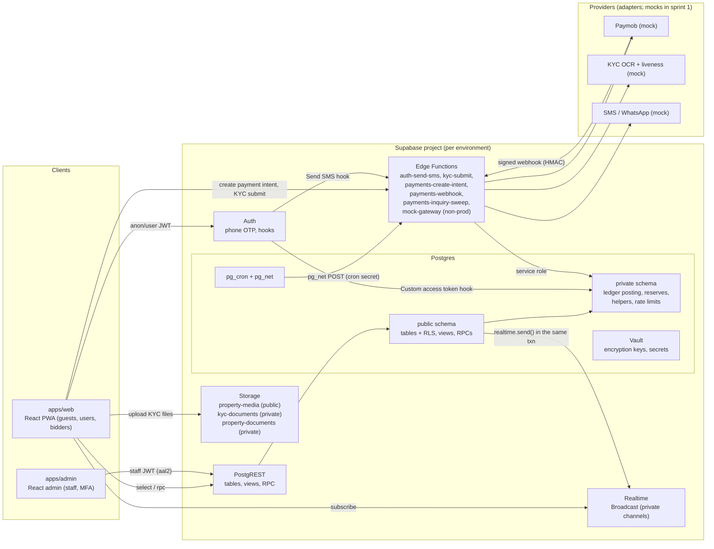

# ADR-002: System architecture, bid serialization, realtime, jobs, ledger and security model

- Status: **proposed** (architect). Needs stakeholder acknowledgement of the risks in §16. The realtime choice in §6 is confirmed or replaced by the ST-012 load test.
- Date: 2026-11-02
- Author: solution-architect
- Builds on: `docs/decisions/ADR-001-stack-platform-and-providers.md` (accepted)
- PRD sections: 2.1–2.3, 3.2, 3.4–3.6, 3.9, 3.10, 8.1.4, 8.2, 8.4, 8.6
- Contracts: `docs/design/contracts/DATA_MODEL.md`, `docs/design/contracts/ST-004.md` … `ST-011.md`
- Amended by: `ADR-006-edge-function-db-access-and-runtime-env.md` (2026-11-03): Edge Functions reach `private` functions only through `public.svc_*` wrappers executable by `service_role`; dev-only Edge Functions check both `APP_ENV` and `private.runtime_env`.

## 1. Context

Benben is an auction-first real-estate app for Egypt. The core risks are money (deposits, forfeitures), fairness (bid order under concurrency), and identity (KYC, PII). ADR-001 fixed the stack: React 19 + Vite on the client, Supabase as the system of record, providers mocked behind adapters, bids serialized in Postgres, and a sprint 1 load test against PRD 8.4 (bid → broadcast p95 < 300 ms, 5,000 concurrent viewers per auction).

This ADR covers every architecture choice that the sprint 1 contracts depend on. For each choice it lists the options considered, the decision and the consequences. Where a choice is cheap to revisit, it says so.

Guiding rules, in priority order:
1. **The server is the only authority** on time, auction state, balances and prices (PRD 8.2).
2. **The database is the security boundary.** RLS is on every table. Critical writes are Postgres functions with explicit checks. The service-role key never reaches a browser.
3. **Boring and few moving parts.** No Redis, no queue service, no separate API server in Phase 1, unless the load test (ST-012) forces one.

## 2. System overview



Request paths in plain words:
- **Reads** (auction detail, bid history, own wallet): `supabase-js` → PostgREST → views/tables protected by RLS.
- **Critical writes from the user** (bid, join, leave): `supabase-js` `rpc()` → a `SECURITY DEFINER` function in `public` that checks everything and calls internal functions in `private`.
- **Writes that need a provider** (payment intent, KYC submit): the browser calls an Edge Function with its user JWT. The function verifies the JWT, calls the provider adapter, and writes through `private` functions with the service role, called via their `public.svc_*` wrappers (ADR-006: `private` is not exposed through the API).
- **Provider callbacks** (payment webhooks): Edge Function → HMAC verify → raw event stored → `public.svc_process_payment_event()` → `private.process_payment_event()` (ADR-006).
- **Fan-out**: the bid function calls `realtime.send()` inside its transaction. The message exists only if the bid commits.

## 3. Repository layout (monorepo)

**Options:** (a) one Vite app with an `/admin` route; (b) a pnpm workspace with two apps and shared packages.
**Decision:** (b). The admin has a different audience (staff, MFA, desktop), a different bundle, and a separate deploy URL, so a bug or a dependency in one cannot leak into the other. Shared code lives in packages.

```
apps/
  web/                 PWA: guests, users, bidders (React 19, Vite, Tailwind, TanStack Query, React Router)
  admin/               Staff dashboard (same stack; separate deploy and URL)
packages/
  db-types/            generated: src/database.ts  (supabase gen types typescript)  - never hand-edited
  shared/              money (piasters), digits, time-sync, error codes, idempotency keys, Zod schemas
  ui/                  design-system tokens and components used by both apps (ST-003)
supabase/
  config.toml          local stack config (auth phone OTP, hooks, test OTP numbers, rate limits)
  migrations/          forward migrations  <timestamp>_<story>_<name>.sql
  migrations-down/     one down script per migration (same file name + .down.sql); CI tests up→down→up
  functions/
    _shared/           adapters/{payments,kyc,sms}/{types.ts,mock.ts,paymob.ts,...}, http.ts, errors.ts, hmac.ts
    auth-send-sms/  kyc-submit/  payments-create-intent/  payments-webhook/
    payments-inquiry-sweep/  mock-gateway/  dev-sms-inbox/
  tests/               pgTAP files  (*.test.sql), run with `supabase test db`
  seed.sql             local seed (synthetic only)
  seed/staging.sql     staging seed (synthetic only), run by the deploy pipeline
tools/
  loadtest/            ST-012 realtime harness (Node + supabase-js), report generator
  ci/                  scripts: check-rls.sql, check-bundle-secrets.sh, check-types-fresh.sh
e2e/                   Playwright specs (run against staging)
docs/ backlog/ prompts/ ai/
```

Note for the orchestrator: `CLAUDE.md` "Repo layout" still says `src/  React app`. With this ADR accepted it should read `apps/web`, `apps/admin`, `packages/*`. Only the orchestrator or a stakeholder edits `CLAUDE.md`.

## 4. Environments

| | local | staging | production |
|---|---|---|---|
| Supabase | `supabase start` (Docker), fresh DB on every `supabase db reset` | Paid Supabase project, nearest region to Egypt (proposal: `eu-central-1` Frankfurt; record the final choice in ST-001) | Separate project. Region decided with counsel before the pilot (Q-06) |
| Data | `supabase/seed.sql`, synthetic | `supabase/seed/staging.sql`, synthetic only | Real data. No agent access |
| Providers | mocks | mocks (`mock-gateway`, mock KYC, mock SMS) | real vendors. `mock-gateway` and `dev-sms-inbox` are **not deployed**; the deploy job fails if they are in the function list |
| `private.runtime_env` | `local` | `staging` | `production` (the default value if the row is missing, so dev-only functions fail closed) |
| Edge Function secret `APP_ENV` (ADR-006) | `local` | `staging` | `production` or unset (unset = production). Dev-only Edge Functions run only when it equals `private.runtime_env` and is not `production` |
| Frontend | Vite dev server | static host with a stable staging URL (devops picks the host in ST-001) | same host, production project |
| Keys in the browser | anon/publishable key only | anon/publishable key only | anon/publishable key only |

Migrations reach staging only through CI after a stakeholder merges to `main` (CLAUDE.md). No dashboard edits.

## 5. Bid serialization

### Options
1. **Row lock on the auction:** `SELECT … FROM auctions WHERE id = $1 FOR NO KEY UPDATE` inside `place_bid()`.
2. **Transaction-level advisory lock:** `pg_advisory_xact_lock(hashtextextended(auction_id::text, 0))`, then read the auction.
3. **Single-writer queue** (one consumer per auction, as in PRD 8.5 with Redis/BullMQ).
4. **Optimistic concurrency:** `UPDATE auctions … WHERE bid_seq = $expected`, retry on conflict.

### Decision: option 1, a row lock with `FOR NO KEY UPDATE`
- `place_bid()` must read and then update the same auction row (`current_price`, leader, `bid_seq`, `ends_at`). Locking the row we update is the simplest correct design. The lock ends at commit or rollback, so it cannot leak, and it works through Supavisor in transaction mode.
- **One serialization point for every writer.** Pause, cancel, end (sweeper), join and bid all take the same row lock. An advisory lock only protects code paths that remember to take it. A row lock also protects against any `UPDATE` on that row.
- **`FOR NO KEY UPDATE`, not `FOR UPDATE`.** Inserts into tables that reference `auctions` (bids, chat messages, participants, events) take `FOR KEY SHARE` on the parent row for the foreign-key check. `FOR UPDATE` would block every chat message while a bid is in progress; `FOR NO KEY UPDATE` does not. Bids still serialize against each other, because `NO KEY UPDATE` conflicts with itself.
- Option 4 makes losers retry, which turns the final-minute burst into a retry storm. Option 3 adds a service that ADR-001 removed.

### Ordering and time
- The bid's `server_ts` is `clock_timestamp()` read **after** the lock is acquired, never `now()`. `now()` is the transaction start time, and a transaction that waited longer for the lock would get an earlier timestamp than the one that beat it.
- Each auction keeps a counter `bid_seq`. Every accepted bid takes `bid_seq + 1`, and `(auction_id, seq)` is unique. `seq` is the total order. Lock order, `seq` order and `server_ts` order are the same by construction.
- The end-time check (`clock_timestamp() < ends_at`) also runs after the lock. A bid that waited past the end is rejected with `AUCTION_ENDED` (A6: the server state rules).
- **A5 (two bids in the same millisecond):** both requests queue on the row lock. The first gets the lock and is accepted. The second then sees the new price. If its amount is below the new minimum, it returns `OUTBID` with `min_next_bid` ("Outbid, new minimum is X"). The client sends `p_expected_seq` (the `bid_seq` it last saw), so the server can say `OUTBID` (someone bid in between) rather than `BID_TOO_LOW` (the client was simply wrong).
- `SET LOCAL lock_timeout = '2s'`. If the lock is not acquired in time, the function returns `BUSY_RETRY` and nothing changes. The client retries with the **same** idempotency key.
- Lock order across all functions, to prevent deadlocks: `payments` → `auctions` → `auction_participants` → `wallets` → `wallet_locks`. Two wallets in one transaction are locked in ascending `id` order.

### Idempotency
- Every bid request carries `p_idempotency_key uuid`, made by the client once per confirmed bid intent and reused on retries.
- `bids` has `UNIQUE (user_id, idempotency_key)`. The function checks for an existing bid before the lock and again after it (READ COMMITTED gives the second check a fresh snapshot). The unique constraint is the last guard: a `unique_violation` is turned into a replay.
- Same key with the same auction and amount: the original result comes back with `replayed = true`. Same key with different parameters: `DUPLICATE_REQUEST`.
- Rejected bids are not stored, so a retry after a rejection is evaluated again. That is safe, because a rejection changes no state.

### Increment table
- `increment_tables` plus `increment_bands(table_id, from_amount, increment)` in piasters. Each auction points to one table (`auctions.increment_table_id`). Tables are immutable once an auction uses them; a change creates a new table. This follows Q-21 (an admin-approved table per auction, which Ops may swap at pricing review).
- The band comes from the **current** price. The minimum next bid is `starting_price` when there are no bids (Q-20), otherwise `current_price + increment(band(current_price))`. Any whole-EGP amount at or above the minimum is valid (Q-21).
- One SQL function, `public.auction_min_next_bid()`, is used both by `place_bid()` and by the `auction_public` view, so the UI and the server can never disagree.

### Consequences
- The lock is held for the whole function, so `place_bid()` must stay short: no HTTP calls and no wallet work. Target: under 5 ms of lock hold time. ST-012 measures it.
- Throughput per auction is bounded by lock hold time, roughly 200 or more bids/s per auction. That is far above any realistic bid rate.
- Anti-sniping (ST-014) slots into the same function, under the same lock. It updates `ends_at` and emits `auction.extended`.

## 6. Realtime fan-out and time sync

### Options
1. **Postgres Changes** on `bids` / `auctions`. Each change is checked against RLS for every subscriber, and it is processed on a single thread per project. At 5,000 subscribers that means 5,000 authorization reads per bid. Supabase's own guidance is to use Broadcast at this scale. It also leaks the table shape to clients.
2. **Broadcast sent from the client** after the RPC returns. It cannot be trusted (anyone could send a fake `bid.placed`) and it is lost if the tab closes.
3. **Broadcast sent from the database** with `realtime.send()` inside the bid transaction, on **private channels** with Realtime Authorization.
4. A dedicated fan-out service (managed, such as Ably or Pusher, or self-hosted, such as Centrifugo or Socket.IO).

### Decision: option 3, now; option 4 is the documented fallback
- `place_bid()` calls `realtime.send(payload, 'bid.placed', 'auction:<id>', true)` inside its transaction. The message is written to `realtime.messages` and published only if the bid commits. This gives transactional outbox behaviour with no extra service.
- **Private channels only.** RLS on `realtime.messages` allows `anon` and `authenticated` to **receive** on `auction:<uuid>` topics, and allows each user to receive on `user:<their uid>`. **No client may send** (no INSERT policy), so broadcasts cannot be spoofed. Day-1 check in ST-012: confirm that the `anon` role can join a private channel. If it cannot, guests use Supabase anonymous sign-in (a JWT with `is_anonymous = true`), and every write function refuses anonymous users.
- Payloads are small, versioned (`v: 1`) and carry `seq`, so clients detect gaps and resync (A6). No user IDs are ever broadcast, only per-auction aliases.
- Presence is **not** used for viewer counts. Presence at 5,000 members per channel is expensive. The bidder count is the cached `participant_count` (Q-32). An approximate viewer count can come later from a periodic server sample.

### Time sync (PRD 3.6: never the device clock)
- RPC `public.server_time()` returns `clock_timestamp()`. On connect, the client takes 3 samples and keeps the one with the smallest round-trip time: `offset = server_ts − (t_send + t_recv) / 2`.
- The client anchors to its **monotonic clock**: `serverNow() = syncedServerTs + (performance.now() − perfAtSync)`. Changing the device clock during a session therefore has no effect. That is the ST-009 acceptance test.
- Re-sync happens on Realtime reconnect, on `visibilitychange` back to visible, and every 5 minutes. Every broadcast carries `server_ts`. If a message arrives "from the future" (`server_ts > serverNow()`), the client corrects its offset forward.
- Countdown: `remaining = ends_at − serverNow()`. `ends_at` always comes from the server: the `auction_public` view, `get_auction_live_state()`, or broadcast payloads.

### Consequences
- The broadcast reads its payload from `realtime.messages` through logical replication. That adds latency we have not measured yet. ST-012 measures it.
- **Plan quotas are the bigger risk** (see §16 R1): one bid fanned out to 5,000 viewers is 5,000 delivered messages.
- **Fallback if ST-012 fails:** keep Postgres as the system of record and `place_bid()` unchanged. The broadcast moves from `realtime.send()` to an outbox table (`realtime_outbox`) drained by a dedicated fan-out service. The client keeps the same channel names and payloads behind a `LiveChannel` interface in `packages/shared`, so the UI does not change. That would be ADR-00x (ST-012).

## 7. Timers and jobs

### Options
1. `pg_cron` calling SQL functions directly, plus a **lazy end-check** inside every write.
2. Edge Function schedulers (Supabase cron → Edge Function) for everything.
3. An external worker (BullMQ) — removed by ADR-001.

### Decision: option 1; Edge Functions only for jobs that need HTTP
- **Correctness never depends on a job running on time.** Every write compares against server time (`clock_timestamp() < ends_at` in `place_bid()`; join checks the state and `ends_at`). Jobs only move state forward and send broadcasts.
- `pg_cron` (sub-minute schedules are supported) runs SQL functions:
  - auction sweeper every 5 s: SCHEDULED → LIVE at `start_at`, LIVE/EXTENDED → ENDED at `ends_at`, then the outcome (ST-013, sprint 2);
  - 48 h deadlines, second-chance expiry and backup-lock release every 60 s (ST-029/030, sprint 4);
  - rate-limit table cleanup hourly (sprint 1).
- Jobs that need HTTP use `pg_cron` + `pg_net` to POST to an Edge Function with a shared `CRON_SECRET` (kept in Vault and in the function's secrets):
  - `payments-inquiry-sweep` every 15 s (A2, sprint 1);
  - reminders and notifications (ST-040/041).
- Every job is idempotent: it selects due rows with `FOR UPDATE SKIP LOCKED`, and each transition is a guarded function (same lock order as §5), so overlapping runs are safe.

### Consequences
- There is no in-memory timer anywhere. A sweeper delay of a few seconds only delays the "ended" broadcast. It never lets a late bid in.
- `pg_cron` runs inside the database, so a database outage also stops jobs. That is acceptable, because nothing can happen without the database anyway.

## 8. Ledger (double entry)

### Options
1. Mutable balance columns (`wallets.available += x`). Rejected by the PRD (2.3, 8.2).
2. A ledger only, with balances computed by `SUM()` on every read.
3. **A double-entry ledger as the source of truth, with cached balances on `wallets`** that only the posting function updates, in the same transaction.

### Decision: option 3
- **Accounts** (`ledger_accounts`). Each user wallet has three credit-normal (liability) accounts: `user_available`, `user_locked`, `user_pending`. System accounts:
  - `gateway_clearing` (asset, debit-normal: money held at or receivable from Paymob);
  - `pending_clearing` (memo asset matching `user_pending`);
  - `revenue_forfeit`, `revenue_premium` (credit-normal);
  - `refunds_payable` (liability: duplicates and refunds owed);
  - `test_funding` (non-prod only; the seed credits wallets through it).
- **Transactions** (`ledger_transactions`) have a type, a **unique idempotency key** and a reference. **Entries** (`ledger_entries`) have `debit` or `credit` as a non-negative `bigint` in piasters. A deferred constraint trigger checks Σdebit = Σcredit per transaction, at least 2 lines, and one currency (EGP).
- **Cached balances.** `wallets.available | locked | pending | forfeited` (all `bigint`, each `CHECK (>= 0)`) are written only by `private.ledger_post()`, in the same transaction as the entries, under a `FOR UPDATE` lock on the wallet row. A trigger rejects any other `UPDATE` of these columns: `ledger_post()` sets a transaction-local flag (`set_config('benben.ledger_posting','on', true)`), and the trigger checks it. `forfeited` is a lifetime total of the user's forfeits (PRD "Forfeited" bucket), not a balance. System accounts are **not** cached, to avoid a hot row. Their balances are `SUM()` queries used by reconciliation.
- **Movements** (all in `private`, never callable by clients):

| Movement | Debit | Credit | Also |
|---|---|---|---|
| Gateway capture (top-up) | gateway_clearing | user_available | `payments.status = paid` |
| Pending notice (async methods) | pending_clearing | user_pending | reversed on capture or expiry |
| Lock (join) | user_available | user_locked | `wallet_locks` row `active` |
| Release | user_locked | user_available | lock `released` |
| Forfeit (default) | user_locked | revenue_forfeit | lock `forfeited`, `wallets.forfeited += x` |
| Apply (premium on completion) | user_locked | revenue_premium | lock `applied` |
| Duplicate capture (A3) | gateway_clearing | refunds_payable | refund case, executed by ST-044 |

- **Join & Lock** is two ledger transactions in **one** database transaction: capture → Available, then lock Available → Locked. The invariant "Locked ≤ what came in" holds at every step, and if the lock is refused (auction ended, A2), the money simply stays in Available.
- **No negative balances:** `CHECK (available >= 0 …)` plus an explicit check in `wallet_lock()` that returns `INSUFFICIENT_BALANCE`.
- **Consistency check:** `private.wallet_reconcile(wallet_id)` compares the cached columns with the ledger sums and with the sum of `active` locks. It is used by the tests now and by daily reconciliation later (ST-043).

### Consequences
- Every balance can be traced to entries. Entries and transactions are append-only (no UPDATE or DELETE grants, and a trigger blocks changes). Corrections are reversing transactions.
- If the CBE answer (Q-05, §16 R3) forbids stored value, `release` changes from "to Available" to "refund to the original source". That is a new movement type, not a schema change.

## 9. Payment webhooks

**Decision:** an Edge Function, `payments-webhook`, which is the only entry point for gateway state changes (PRD 8.2):
1. Read the **raw body**. The adapter verifies the signature: the mock uses HMAC-SHA256 over the raw body in `x-benben-signature`; Paymob uses HMAC-SHA512 over its documented field order. Comparison is constant-time, and the secret is `PAYMENTS_HMAC_SECRET` in function secrets.
2. **Always store the event** in `payment_webhook_events` (raw payload, redacted headers, `signature_valid`). This includes invalid ones, for forensics.
3. Invalid signature → HTTP 401, event marked `rejected_signature`, nothing else changes.
4. Valid → `private.process_payment_event(event_id)`, which takes `FOR UPDATE` on the payment and applies the transition. **Idempotency:** `payments.gateway_txn_id` is unique; an event that was already applied is a no-op (`duplicate_event`); a second successful capture for the same intent with a different `gateway_txn_id` is a **double charge (A3)**, credited to `refunds_payable` and flagged for auto-refund.
5. Amount or currency that does not match the intent → `AMOUNT_MISMATCH`: no credit, flagged for Finance.
6. Return 200 for processed or duplicate events, so the gateway stops retrying.

The redirect back from checkout never changes state (PRD 2.3 rule 1). It only shows "Payment pending" until the user channel receives `payment.updated`. **A2** polling: `payments-inquiry-sweep` calls the adapter's inquiry API for `pending` payments every 15 s for up to 10 min after creation (both values in `app_settings`). Its results go through the same `process_payment_event()` path, as synthetic events with `source = 'inquiry'`.

## 10. Identity, roles and the RLS model

- **Users** are `auth.users` (phone OTP) plus `public.profiles` (the PRD `users` entity: `kyc_tier`, `roles[]`, `status`, `banned_until`). A trigger on `auth.users` insert creates the profile, the wallet and its three ledger accounts.
- **Database roles:** `anon` (guest), `authenticated` (registered user), `service_role` (Edge Functions and CI only). There are no other Postgres login roles.
- **App roles:**
  - **owner** means `user_id = auth.uid()` on the row;
  - **Verified Bidder** is not a global role: it is an `auction_participants` row with `status = 'active'` for that auction;
  - customer roles (seller, broker, …) are `profiles.roles user_role[]`, written only by server functions;
  - **staff RBAC** (PRD 8.1.4, Q-69) uses tables: `staff_members`, `staff_roles`, `staff_role_permissions`, `staff_member_roles`. Roles are bundles of permissions (`auction.control`, `bid.void`, `finance.read`, `kyc.review`, …), and one person can hold several. Maker-checker approvals (second approver) are ST-020/ST-026.
- **Custom JWT claims: options.** (a) put roles and tier into the JWT through the Custom Access Token hook; (b) check tables at query time.
  **Decision:** (b) for every authorization decision. JWT claims go stale for up to the token lifetime (default 1 h), which is not acceptable for bans, KYC tier or staff revocation. The Custom Access Token hook is used for one thing only: **refusing to issue tokens to banned users**, with the error `USER_BANNED`, so the app can show the reason (ST-004).
- **Helpers** (`private` schema, `SECURITY DEFINER`, `STABLE`, `search_path = ''`): `private.has_permission(text)` (also requires the JWT `aal = 'aal2'`, so staff must have MFA), `private.is_staff()`, `private.user_can_transact()`. Policies call them as `(select private.has_permission('x'))`, so Postgres evaluates them once per statement (initPlan).
  - `anon` and `authenticated` get `USAGE` on schema `private` and `EXECUTE` only on these helpers (needed to evaluate policies). `private` is **not** in the PostgREST exposed schemas, so nothing in it can be called through the API.
- **Defaults to remove:** Supabase grants `EXECUTE` on new functions in `public` to `anon` and `authenticated`. Every migration does `REVOKE EXECUTE … FROM public, anon, authenticated` and then grants explicitly. A CI check fails if any table in `public` or `private` has RLS off (ST-001).
- **Public projections.** Tables that hold sensitive columns (`auctions.status`, `auctions.seller_id`, `bids.user_id`, `properties.owner_id`) are read by clients through `security_invoker` views (`auction_public`, `bid_public`, `property_public`). Column-level `GRANT SELECT (col, …)` on the base table allows only the safe columns, and RLS on the base table still applies. Generated types then expose only safe fields.

## 11. Audit

- `auction_events`: an append-only stream per auction (started, participant joined, bid, extended, paused, ended, …), written only by server functions, readable by staff with `auction.read`.
- `audit_logs`: admin and system actions with `before_json` / `after_json`, reason, actor, IP and request id (PRD 8.1.4, 8.2).
- Both are append-only: no UPDATE or DELETE grants to any client role, a `BEFORE UPDATE OR DELETE` trigger that raises, and identity primary keys. They are retained for at least 5 years (PRD 8.2). Ledger tables follow the same append-only rule.
- `tc_acceptances` is the consent log (PRD 3.4, 8.2) and is also append-only.

## 12. Encryption of PII and the reserve price

### Options
1. pgsodium Transparent Column Encryption. Supabase has deprecated it, so it is rejected.
2. **`pgcrypto` symmetric encryption with keys kept in Supabase Vault**, used only inside `SECURITY DEFINER` functions.
3. Application-level encryption in Edge Functions (keys in function secrets).

### Decision: option 2, plus data separation
- **Reserve price:** a separate table, `private.auction_reserves (auction_id, reserve_enc bytea)`, encrypted with `pgp_sym_encrypt` using Vault secret `reserve_key`. The table is in the non-exposed schema and has no client grants. It is decrypted only inside server functions (close outcome in ST-013, the seller and Ops views later). No client role can read it, and guests and bidders get no reserve indicator (Q-22).
- **National ID number:** stored as `national_id_enc` (pgp_sym with Vault `pii_key`) plus `national_id_hash` (HMAC-SHA256 with a separate Vault `pii_pepper`) for duplicate detection (A12, Q-39) without decrypting. Only `national_id_last4` is shown to the user.
- **KYC images:** private bucket `kyc-documents`, no public URLs. The owner can upload only; the KYC Reviewer can read through short-lived signed URLs.
- Everything is also covered by Supabase's disk encryption at rest and TLS in transit (PRD 8.4).
- **Consequences:** key rotation means re-encrypting with a new Vault secret (a function, plus a `key_version` column). Option 3 stays possible for documents if a KYC vendor requires it.

## 13. Provider adapters and mocks

Every provider sits behind a TypeScript interface in `supabase/functions/_shared/adapters/`. The implementation is chosen by an environment variable (`PAYMENTS_PROVIDER`, `KYC_PROVIDER`, `SMS_PROVIDER` = `mock` | real vendor):

- `PaymentGateway`: `createIntent()`, `verifyWebhook(rawBody, headers)`, `parseEvent()`, `inquire(merchantOrderId)`, `refund()` (later).
- `KycProvider`: `submit(case, files)` → `{ status: 'completed' | 'pending', result? }`, `parseCallback()` (for async vendors).
- `SmsSender`: `send(phone, templateId, vars)`.

Mocks are realistic (ADR-001). The mock gateway (`mock-gateway` Edge Function plus the staging-only PAY-01 page) simulates `success`, `decline:<reason>`, `delay:<seconds>`, `duplicate` and `invalid_signature`, and serves an inquiry API. The mock KYC returns fixtures chosen by test National ID numbers. The mock SMS writes to `private.dev_sms_outbox`, which QA reads through `dev-sms-inbox` (non-prod, QA token). Callers depend on the interface only, so swapping in a real vendor changes no caller (ST-005, ST-007 acceptance criteria).

## 14. Load-test plan (ST-012, PRD 8.4)

- **Harness:** `tools/loadtest` (Node 22 + `@supabase/supabase-js`, one process per 1,000 sockets, 5 or more generator VMs in the same cloud region as staging, plus one generator in or near Egypt for a real-network sample).
- **Scenario:** 1 staging auction; 4,900 anon viewers + 100 authenticated participants, all subscribed to `auction:<id>`; hold for 15 min or more. Bids go through the real `place_bid()` RPC: 1 bid/s for 10 min, then a final-minute burst of 20 bids/s from 50 bidders, including same-millisecond pairs (A5).
- **Metric:** per message, `latency = receive_time_local − bid.server_ts`. Each generator corrects its local clock with the same `server_time()` min-RTT method as the app, and logs its offset error bound. `server_ts` is set before commit, so the measure is slightly pessimistic.
- **Report:** p50/p95/p99 latency; connection success rate; lost messages (gaps in `seq` per subscriber); misordered messages; `place_bid` p95 under load; lock-wait time; Realtime quota counters used; plan needed for the pilot (Q-45: 10 LIVE auctions, 10,000 connections).
- **Pass:** p95 < 300 ms, 0 lost, 0 misordered, connection success ≥ 99.5 %, `place_bid` p95 < 150 ms.
- **Fallback if it fails:** in this order:
  1. if quota-bound, raise limits (plan or Enterprise) and rerun;
  2. if latency-bound in `realtime.send()`, switch to the outbox plus Realtime REST broadcast from an Edge Function and rerun;
  3. otherwise, an ADR for a dedicated fan-out service (§6), with Supabase staying the system of record.

The stakeholder hears the result in the sprint 1 review.

## 15. What the no-data stories need from the architecture

**ST-001 (repo, CI, staging):**
- **Layout:** §3. Package manager `pnpm`, Node 22 LTS, Supabase CLI pinned in `package.json`.
- **CI** on every PR to `st-###-*`, all required:
  1. `pnpm lint`, `pnpm typecheck`, `pnpm test` (Vitest);
  2. `supabase start` + `supabase db reset` — **all migrations apply on a fresh database**, then the seed;
  3. down-script check for migrations changed in the PR: apply up → `migrations-down/<file>.down.sql` → up again;
  4. `supabase test db` (pgTAP RLS and function tests);
  5. `supabase db lint` with level warning;
  6. `tools/ci/check-rls.sql`: fails if any table in `public` or `private` has `relrowsecurity = false`, or any `public` function is executable by `anon`/`authenticated` without being on the allow-list in `tools/ci/rpc-allowlist.txt`;
  7. types freshness: `supabase gen types typescript --local > /tmp/db.ts && diff -q /tmp/db.ts packages/db-types/src/database.ts`;
  8. bundle secret scan: build both apps and grep `dist/` for `service_role`, `sb_secret_`, and the decoded JWT role string; fail on any match;
  9. Edge Function tests (`deno test supabase/functions`).
- **Deploy on merge to `main`** (stakeholder merge only): `supabase db push` to staging, `supabase functions deploy` (excluding prod-forbidden functions in prod), set `private.runtime_env`, run `seed/staging.sql` (idempotent), build and deploy both apps.
- **Env vars.** Browser (`VITE_*` only):
  - `VITE_SUPABASE_URL`;
  - `VITE_SUPABASE_ANON_KEY` (the publishable key);
  - `VITE_APP_ENV` (`local` | `staging` | `production`);
  - `VITE_MOCK_GATEWAY_URL` (non-prod).
- **Function secrets:**
  - `SUPABASE_SERVICE_ROLE_KEY` (auto-provided);
  - `APP_ENV` (`local` | `staging` | `production`; set by the deploy, ADR-006);
  - `PAYMENTS_PROVIDER`, `PAYMENTS_HMAC_SECRET`, `PAYMOB_API_KEY` (later);
  - `KYC_PROVIDER`, `KYC_AUTO_APPROVE_MIN_SCORE` (or `app_settings`);
  - `SMS_PROVIDER`, `SEND_SMS_HOOK_SECRET`;
  - `CRON_SECRET`, `QA_INBOX_TOKEN` (non-prod).
- **CI secrets:** `SUPABASE_ACCESS_TOKEN`, `SUPABASE_DB_PASSWORD`, `STAGING_PROJECT_REF`.
- **Vault secrets** (set by the deploy job, never in Git): `pii_key`, `pii_pepper`, `reserve_key`, `cron_secret`.

**ST-002 (shell, i18n, money):**
- `packages/shared/money.ts` handles piasters as `bigint` (or `number` while below 2^53; amounts up to 9e15 piasters are safe, and the guard throws above that).
- `formatEGP(piasters, locale, digits)` uses `Intl.NumberFormat` with integer division for display only, never float maths.
- `parseEGPInput(str)` normalises Arabic-Indic digits and returns piasters.
- Timezone `Africa/Cairo` for all displays.
- The server sends every amount as an integer piaster value. Columns are `bigint`; PostgREST serialises `bigint` as a JSON number, which is safe below 2^53.

**ST-003 (design system):**
- The countdown component takes a `remainingMs` derived from `serverNow()` (§6), never `Date.now()`.
- `packages/ui` is shared by both apps.

**ST-012 (load test):** §14. The harness needs:
- a staging auction created by `private.dev_create_demo_auction()`;
- 100 synthetic bidders with T1 and active locks, created by `private.dev_seed_bidders(auction_id, n)` (non-prod only);
- the `auction:<id>` channel contract from `ST-010.md`.

## 16. Risks the stakeholder must decide on

| # | Risk | Impact | Proposal |
|---|---|---|---|
| R1 | **Supabase Realtime quotas.** Fan-out counts per delivered message. 1 bid fanned out to 5,000 viewers = 5,000 messages; a final-minute burst of 20 bids/s = 100,000 msg/s. Published plan caps (verify on the pricing page during ST-012) are about 500 msg/s on Pro, about 2,500 msg/s on Pro without spend cap or Team, and 10,000 concurrent connections at most outside Enterprise. | The latency target may be met while the **quota** is not, even at 1 bid/s. Pilot sizing (Q-45: 10,000 connections) sits at the edge of the non-Enterprise ceiling. | Budget now for either Supabase Enterprise (custom Realtime limits) or a dedicated fan-out service in sprint 2–3. ST-012 gives the measured answer by 2026-11-15. |
| R2 | **Data residency (Q-06).** Supabase has no Egypt region. National ID images, selfies (biometrics) and NID numbers would sit in the EU. | PDPL 151/2020 may require a licence for cross-border transfer, or local storage. The region is hard to change after launch. | Staging stays synthetic only. Counsel answers before the pilot (by 2027-01-10). The architecture keeps KYC files behind a storage path and adapter so they could move to the KYC vendor or an in-country store. |
| R3 | **CBE stored-value licence (Q-05).** The "Available" bucket is stored value. | It may not be allowed without a licensed partner. | The ledger records funds held by a licensed partner (Q-05 default). If needed, "release" becomes "refund to source" (§8), which needs no schema change. |
| R4 | **Bid fat-finger.** The PRD sets no maximum bid. A mistyped extra zero becomes a binding bid, and a default then costs EGP 5,000. | User harm and disputes. | Add a configurable sanity cap (`bid.max_increments_above_min`, default 100 increments above the minimum, error `BID_TOO_HIGH`) on top of the confirmation sheet. **Assumption, needs stakeholder confirmation.** |
| R5 | **Realtime authorization for anon** (private channels) is unproven on our plan. | Guests may need anonymous sign-in. | Verified on day 1 of ST-012; fallback in §6. |
| R6 | **Supabase Auth ban vs app ban.** We gate bans in the token hook and in every write function. Already-issued tokens stay valid for reads until expiry (≤ 1 h). | A banned user could keep reading public data for up to an hour. They can never write. | Accept, or lower the JWT expiry to 15 min. |
