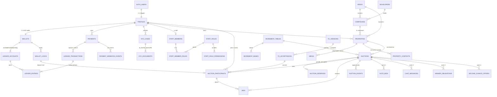

# Benben data model (Phase 1) and shared contract conventions

- Owner: solution-architect · Date: 2026-11-02 · Status: draft for sprint 1
- Decisions: `docs/decisions/ADR-002-architecture.md`
- Per-story contracts: `ST-004.md` (identity, roles, foundation), `ST-005.md` (KYC), `ST-006.md` (ledger), `ST-007.md` (payments), `ST-008.md` (T&Cs, participants, join), `ST-009.md` (catalog, auctions, read side), `ST-010.md` (bids, place_bid, channel), `ST-011.md` (frontend use of all of the above)

This file is the single source for **conventions, enums and the error vocabulary**. Story contracts reference it and must not redefine these items.

---

## 1. Conventions (apply to every contract)

| Topic | Rule |
|---|---|
| Money | `bigint` piasters (1 EGP = 100 piasters). Column suffix `_amount` or `price`. Never `numeric`/`float` for money. `currency char(3) not null default 'EGP' check (currency = 'EGP')`. Percentages are integer **basis points** (`_bps`, 250 = 2.5 %). |
| Ids | `uuid primary key default gen_random_uuid()`. Append-only logs use `bigint generated always as identity`. |
| Time | `timestamptz`. Server sets every authoritative time (`clock_timestamp()` in critical functions). Display in `Africa/Cairo`. |
| Schemas | `public`: tables, views and RPCs reachable through PostgREST. `private`: internal functions, secret tables (reserves, rate limits, dev outbox). It is not exposed through the API. |
| RLS | Enabled on **every** table in `public` and `private`. Default is deny. Policies are named `<table>_<role>_<action>`. |
| Grants | Clients get the minimum: `SELECT` (sometimes column-scoped) and, rarely, column-scoped `UPDATE`. **No client `INSERT`/`UPDATE`/`DELETE`** on money, bid, auction, KYC decision or log tables. |
| Functions | Critical writes are `SECURITY DEFINER`, `SET search_path = ''`, fully qualified names, `REVOKE EXECUTE … FROM public, anon, authenticated` and then an explicit `GRANT`. Internal building blocks live in `private`. |
| Idempotency | Every money or bid write takes an `idempotency_key` (`uuid` from the client, or a deterministic text key built server-side, e.g. `payment:<id>:capture`). Same key + same params → the original result with `replayed = true`. Same key + different params → `DUPLICATE_REQUEST`. |
| RPC result envelope | Business outcomes are **returned**, not raised, so that counters (rate limits) commit and the client gets context. Each critical RPC returns a composite type with `ok boolean`, `error_code text` (null when ok) and typed fields. Exceptions (HTTP 4xx/5xx from PostgREST) mean a programming or infrastructure error and are shown as `INTERNAL_ERROR`. |
| Edge Function envelope | JSON `{ "ok": true, "data": {...} }` or `{ "ok": false, "error_code": "X", "message": "...", "details": {...} }`. HTTP status: 200 ok, 400 validation, 401 auth/signature, 403 forbidden, 409 conflict/duplicate, 429 rate limited, 502 provider error. |
| Append-only | `auction_events`, `audit_logs`, `ledger_transactions`, `ledger_entries`, `tc_acceptances`, `payment_webhook_events`: no client write grants, and `BEFORE UPDATE OR DELETE` trigger `private.forbid_mutation()` raises. Retained ≥ 5 years. |
| Realtime | Broadcast on private channels only. `auction:<auction_id>` (receive: anon + authenticated), `user:<user_id>` (receive: that user only). Clients never send. Payloads carry `v`, `server_ts` and, where ordered, `seq`. |
| Migrations | One migration (plus a down script) per story area, prefixed with the story id: `20261103090000_st004_identity.sql`. The order in §5 must hold so a fresh DB applies cleanly. |

## 2. Phase 1 ERD (sprint 1 tables in bold boxes; later sprints marked)



## 3. Table list

### 3.1 Sprint 1 (contracts in this folder)
| Table / view | Schema | Story | Purpose |
|---|---|---|---|
| `profiles` | public | ST-004 | PRD `users`: tier, roles, status, bans, prefs |
| `staff_members`, `staff_roles`, `staff_role_permissions`, `staff_member_roles` | public | ST-004 (seed), UI in ST-020 | Admin RBAC (PRD 8.1.4, Q-69) |
| `app_settings` | public | ST-004 | Config store (deposit, increments default, thresholds, limits) |
| `audit_logs` | public | ST-004 | Append-only admin and system actions |
| `rate_limit_counters` | private | ST-004 | Fixed-window counters for OTP, bids, KYC, joins |
| `runtime_env` | private | ST-004 | Single row: `local`/`staging`/`production` (fail-closed) |
| `dev_sms_outbox` | private | ST-004 | Mock SMS inbox (non-prod only) |
| `kyc_cases`, `kyc_documents` | public | ST-005 | KYC T1 attempts, results and files |
| `kyc_vendor_results` | private | ST-005 | Raw vendor payloads (NID redacted) |
| `wallets`, `ledger_accounts`, `ledger_transactions`, `ledger_entries`, `wallet_locks` | public | ST-006 | Double-entry ledger |
| `payments`, `payment_webhook_events` | public | ST-007 | Gateway intents, raw signed events |
| `mock_gateway_transactions` | private | ST-007 | Mock gateway state (non-prod) |
| `tc_versions`, `tc_acceptances` | public | ST-008 | Versioned T&Cs and the consent log |
| `auction_participants` | public | ST-008 | Verified Bidder per auction (alias, lock) |
| `areas`, `compounds`, `developers` | public | ST-009 | Lookups (synthetic on staging, Q-74) |
| `properties` (+ view `property_public`) | public | ST-009 | The hub (PRD 8.6) |
| `property_contexts` | public | ST-009 | One active context per property (auction/listing/…) |
| `media` | public | ST-009 | Polymorphic media (photos, condition report) |
| `increment_tables`, `increment_bands` | public | ST-009 (tables), ST-010 (logic) | Bid increment bands |
| `auctions` (+ view `auction_public`) | public | ST-009 | Auction state, prices, timers |
| `auction_reserves` | private | ST-009 | Encrypted reserve price |
| `auction_events` | public | ST-009 (table), ST-008/ST-010 (writers) | Append-only auction audit stream |
| `bids` (+ view `bid_public`) | public | ST-010 | Accepted bids, total order by `seq` |

### 3.2 Phase 1, later sprints (not specified yet; must attach to the hubs above without rework)
| Table | Sprint / story | Attaches to |
|---|---|---|
| `auto_bids` | S2 ST-015 | auctions, auction_participants |
| `chat_messages` | S2 ST-018 | auctions, auction_participants (alias) |
| `watchlists`, `reminders` | S2 ST-016 | profiles, auctions |
| `approval_requests` (maker-checker) | S2 ST-020, S3 ST-026 | staff_members, any entity (`entity`, `entity_id`) |
| `kyc_cases` with `tier_target = 'T2'`, `documents` | S3 ST-021 | profiles, private `property-documents` bucket |
| `auction_requests` (seller/Ops creation) | S3 ST-023/024 | properties, auctions |
| `winner_obligations`, `second_chance_offers` | S4 ST-029/030 | auctions, auction_participants, wallet_locks |
| `strikes` | S4 ST-030, S7 ST-047 | profiles (shared across sections) |
| `listings`, `listing_reports`, `saved_searches` | S5 ST-033..038 | properties via `property_contexts` |
| `notifications`, `push_subscriptions` | S6 ST-040/041 | profiles |
| `withdrawals`, `refunds`, `chargebacks` | S6 ST-042/044 | payments, ledger_transactions, wallet_locks |
| `reconciliation_runs` | S6 ST-043 | payments, ledger_entries |
| `linked_account_signals` | S7 ST-046 | profiles (NID hash, phone, card fingerprint, device id) |
| `privacy_requests` | S7 ST-051 | profiles |

### 3.3 Phases 2–4 (epics only)
| Table(s) | Phase | Attaches to |
|---|---|---|
| `buyer_requests`, `deals`, `broker_profiles`, `commission_attributions` | 2 | profiles, properties |
| `investment_listings`, `tenancies`, `yield_auction_links` | 2 | properties via `property_contexts`, auctions |
| `rental_listings`, `rental_applications`, `leases`, `rent_invoices`, `escrow_deposits` | 3 | properties via `property_contexts`, wallet_locks (`purpose = 'rental_deposit'`), payments |
| `contracts`, `signatures` | 3 | auctions, leases (polymorphic `ref_type/ref_id`) |
| `disputes`, `dispute_evidence` | 3 | polymorphic `ref_type/ref_id`, wallet_locks (escrow) |
| `developer_accounts`, `bulk_auction_events` | 4 | profiles, auctions |

**Why no rework:** properties are the hub (PRD 8.6). Every sellable or rentable context registers in `property_contexts` (`context_type`, `context_id`, `active`), with `UNIQUE (property_id) WHERE active`. New phases add a `context_type` value and their own table. Money always flows `payments → ledger_transactions/entries → wallet_locks`, and new purposes are enum values on `lock_purpose` and `ledger_txn_type`.

## 4. Shared enums (created once, in the migration of the first story that needs them)

| Enum | Values | Created in |
|---|---|---|
| `kyc_tier` | `T0`, `T1`, `T2` (ordered) | ST-004 |
| `user_role` | `registered`, `seller`, `broker`, `developer`, `tenant`, `landlord` | ST-004 |
| `user_status` | `active`, `suspended`, `banned` | ST-004 |
| `actor_type` | `user`, `staff`, `system`, `gateway`, `vendor` | ST-004 |
| `kyc_case_status` | `draft`, `submitted`, `approved`, `needs_review`, `rejected`, `failed` | ST-005 |
| `kyc_document_type` | `national_id_front`, `national_id_back`, `selfie` (T2 types added in ST-021) | ST-005 |
| `ledger_account_kind` | `user_available`, `user_locked`, `user_pending`, `gateway_clearing`, `pending_clearing`, `revenue_forfeit`, `revenue_premium`, `refunds_payable`, `test_funding` | ST-006 |
| `ledger_txn_type` | `payment_capture`, `payment_pending`, `payment_pending_reversal`, `lock`, `release`, `forfeit`, `apply`, `duplicate_capture`, `refund`, `reversal`, `test_funding` | ST-006 |
| `lock_purpose` | `auction`, `seller_commitment`, `rental_deposit` | ST-006 |
| `lock_status` | `active`, `frozen`, `released`, `forfeited`, `applied` | ST-006 |
| `payment_purpose` | `topup`, `join_lock` | ST-007 |
| `payment_status` | `pending`, `paid`, `declined`, `expired`, `cancelled` | ST-007 |
| `payment_method` | `card`, `wallet`, `fawry` | ST-007 |
| `payment_outcome` | `none`, `credited_available`, `credited_and_locked`, `refund_required`, `flagged_mismatch` | ST-007 |
| `participant_status` | `active`, `left`, `released`, `winner`, `backup`, `forfeited` | ST-008 |
| `property_type` | `apartment`, `duplex`, `penthouse`, `studio`, `townhouse`, `twin_house`, `villa`, `chalet`, `office`, `retail`, `land` | ST-009 |
| `finishing_type` | `core_shell`, `semi_finished`, `fully_finished`, `furnished` | ST-009 |
| `delivery_status` | `ready`, `off_plan` | ST-009 |
| `verified_status` | `unverified`, `pending`, `verified`, `rejected` | ST-009 |
| `media_kind` | `image`, `video`, `floor_plan`, `condition_report`, `tour_360` | ST-009 |
| `media_visibility` | `public`, `private` | ST-009 |
| `context_type` | `auction` (Phase 1: `listing`; later `rental_listing`, `investment_listing`) | ST-009 |
| `auction_status` | `DRAFT`, `PENDING_REVIEW`, `APPROVED`, `REJECTED`, `SCHEDULED`, `LIVE`, `EXTENDED`, `PAUSED`, `ENDED`, `AWAITING_WINNER`, `RESERVE_NOT_MET`, `SELLER_DECISION`, `NO_BIDS`, `WINNER_DEFAULTED`, `SECOND_CHANCE`, `COMPLETED`, `CANCELLED`, `RELISTED`, `MOVED_TO_MARKETPLACE` (full list now so ST-013 adds no enum churn) | ST-009 |
| `auction_public_status` | `hidden`, `upcoming`, `live`, `extended`, `paused`, `ended`, `sold`, `cancelled` | ST-009 |
| `auction_event_type` | `created`, `scheduled`, `started`, `participant_joined`, `participant_left`, `bid`, `extended`, `paused`, `resumed`, `ended`, `outcome`, `cancelled`, `bid_voided`, `winner_defaulted`, `second_chance_offered`, `completed` | ST-009 |
| `bid_type` | `manual`, `auto` | ST-010 |
| `bid_status` | `valid`, `voided` | ST-010 |

Mapping `auction_status` → `auction_public_status` (Q-22: post-close outcome states must not reveal the reserve result):

| Internal | Public |
|---|---|
| DRAFT, PENDING_REVIEW, APPROVED, REJECTED | `hidden` |
| SCHEDULED | `upcoming` |
| LIVE | `live` |
| EXTENDED | `extended` |
| PAUSED | `paused` |
| ENDED, AWAITING_WINNER, RESERVE_NOT_MET, SELLER_DECISION, NO_BIDS, WINNER_DEFAULTED, SECOND_CHANCE, RELISTED, MOVED_TO_MARKETPLACE | `ended` |
| COMPLETED | `sold` |
| CANCELLED | `cancelled` |

## 5. Migration order for sprint 1 (fresh DB must apply in this order)
1. `st004_foundation_identity`: extensions (`pgcrypto`, `pg_cron`, `pg_net`, `supabase_vault`), schema `private`, shared helpers (`private.forbid_mutation`, `private.has_permission`, `private.hit_rate_limit`, `private.client_ip`), `runtime_env`, `app_settings`, `audit_logs`, `profiles`, staff RBAC tables and seed, auth hooks, `dev_sms_outbox`.
2. `st006_ledger`: ledger enums and tables, system accounts, posting and lock functions. It extends the new-user trigger to create the wallet and accounts.
3. `st005_kyc`: KYC tables, bucket and policies, functions.
4. `st009_catalog_auctions`: lookups, properties, property_contexts, media, increment tables, auctions, auction_reserves, auction_events, views, read RPCs, realtime policies.
5. `st007_payments`: payments, webhook events, mock gateway state, processing functions, cron.
6. `st008_join`: tc_versions, tc_acceptances, auction_participants, join/leave functions. It extends `process_payment_event` for `join_lock`.
7. `st010_bids`: bids, `bid_public`, `place_bid`.

ST-007 and ST-008 both touch `process_payment_event`. ST-007 ships `topup` handling; ST-008 adds the `join_lock` branch with `CREATE OR REPLACE`.

## 6. Shared error vocabulary

Frontend: `packages/shared/src/errors.ts` exports `type ErrorCode = …` with exactly these strings and an i18n key `errors.<CODE>` (AR + EN). No contract may invent a code that is not listed here; to add one, the code is first added to this table.

| Code | Meaning | Returned by | Extra fields | UI copy (EN draft) |
|---|---|---|---|---|
| `NOT_AUTHENTICATED` | No valid user JWT | all user RPCs/EFs | — | "Please log in to continue." |
| `ANONYMOUS_NOT_ALLOWED` | Anonymous session tried a write | all write RPCs | — | "Please log in to continue." |
| `USER_BANNED` | `profiles.status = banned` (or `banned_until > now`) | token hook, all writes | `reason_code`, `banned_until` | "Your account is blocked: {reason}." |
| `USER_SUSPENDED` | Bidding/transacting suspended | join, bid, payments | `suspended_until` | "Your account is suspended until {date}." |
| `KYC_REQUIRED` | Tier below the required one | join, payments (`join_lock`) | `required_tier` | "Verify your ID to continue." |
| `INVALID_INPUT` | Validation failed | all | `field` | "Please check {field}." |
| `INVALID_AMOUNT` | Amount ≤ 0, not whole EGP, or over the limit | bid, payments | `field` | "Enter a whole EGP amount." |
| `NOT_FOUND` | Generic missing row (owner scope) | various | `entity` | "Not found." |
| `RATE_LIMITED` | Too many requests in the window | OTP hook, bid, KYC, join, payments | `retry_after_ms` | "Too many attempts. Try again in {s}s." |
| `DUPLICATE_REQUEST` | Idempotency key reused with different parameters | all idempotent writes | — | "This request was already used. Please try again." |
| `BUSY_RETRY` | Lock timeout; nothing changed; retry with the same key | bid, join | `retry_after_ms` | (silent retry, then) "Busy, retrying…" |
| `INTERNAL_ERROR` | Unexpected failure | all | `request_id` | "Something went wrong." |
| `INVALID_PHONE` | Not an Egyptian mobile in E.164 | SMS hook / client | — | "Enter a valid Egyptian mobile number." |
| `OTP_INVALID` | Wrong code (mapped from Auth) | auth | — | "The code is not correct." |
| `OTP_EXPIRED` | Code expired (mapped from Auth) | auth | — | "The code has expired. Request a new one." |
| `OTP_RATE_LIMITED` | Too many OTP sends or verifications | SMS hook / Auth | `retry_after_ms` | "Too many codes requested. Try again later." |
| `INVALID_NATIONAL_ID` | Fails the 14-digit structure check | kyc-submit | — | "Enter your 14-digit National ID." |
| `KYC_ALREADY_VERIFIED` | Tier already ≥ target | kyc_start_case | — | "You are already verified." |
| `KYC_IN_PROGRESS` | A case is `submitted`/`needs_review` | kyc_start_case | `case_id`, `status` | "Your verification is under review." |
| `KYC_DOCUMENTS_MISSING` | Required file not uploaded | kyc-submit | `missing[]` | "Upload {doc}." |
| `KYC_ATTEMPTS_EXCEEDED` | Too many failed cases in 24 h | kyc_start_case | `retry_after_ms` | "Too many attempts. Try again tomorrow." |
| `KYC_VENDOR_ERROR` | Provider unavailable or timeout (retryable) | kyc-submit | — | "Verification service is busy. Try again." |
| `INSUFFICIENT_BALANCE` | Available < required | wallet_lock, join | `available`, `required`, `shortfall` | "Insufficient balance." |
| `WALLET_FROZEN` | Wallet frozen (A4, later) | wallet functions | — | "Your wallet is on hold. Contact support." |
| `LOCK_NOT_ACTIVE` | Release/forfeit/apply on a non-active lock | wallet functions (internal) | `status` | — |
| `TC_NOT_ACCEPTED` | Checkbox not confirmed | join, payments (`join_lock`) | — | "Please accept the terms." |
| `TC_VERSION_OUTDATED` | Accepted version is not current | join, payments | `current_version_id` | "The terms were updated. Please review them." |
| `AUCTION_NOT_FOUND` | No such auction, or hidden | join, bid, live state | — | "Auction not found." |
| `AUCTION_NOT_JOINABLE` | State not in SCHEDULED/LIVE/EXTENDED/PAUSED, or ended | join, payments (`join_lock`) | `status` (public) | "This auction is no longer open to join." |
| `SELLER_CANNOT_JOIN` | Seller of this auction | join, payments | — | "You cannot bid on your own auction." |
| `CANNOT_LEAVE_LIVE` | Leave after LIVE (Q-23) | leave_auction | — | "You can leave only before the auction starts." |
| `NOT_JOINED` | Leave without an active participation | leave_auction | — | — |
| `ALREADY_JOINED` | `join_lock` payment requested for an auction the user already joined (`join_auction` itself returns `ok` with `already_joined = true` instead) | payments-create-intent | `participant_id` | "You have already joined this auction." |
| `PAYMENT_NOT_NEEDED` | `join_lock` intent while Available ≥ deposit | payments-create-intent | `available` | (client calls `join_auction` instead) |
| `NOT_PARTICIPANT` | No active lock for this auction | bid | — | "Join to bid in this auction." |
| `AUCTION_NOT_LIVE` | Not LIVE/EXTENDED (e.g. SCHEDULED) | bid | `status` (public) | "Bidding has not started." |
| `AUCTION_PAUSED` | PAUSED | bid | — | "Bidding is paused." |
| `AUCTION_ENDED` | `server time ≥ ends_at`, or ended state | bid | `ends_at` | "The auction has ended." |
| `ALREADY_LEADING` | Bidder is the current leader | bid | — | "You are leading." |
| `OUTBID` | Someone bid after the client's `expected_seq`; amount < new minimum (A5) | bid | `min_next_bid`, `current_price`, `seq` | "Outbid, new minimum is {min_next_bid}." |
| `BID_TOO_LOW` | Amount < minimum with no new bid since `expected_seq` | bid | `min_next_bid`, `current_price`, `seq` | "Minimum bid is {min_next_bid}." |
| `BID_TOO_HIGH` | Above the sanity cap (assumption, ADR-002 R4) | bid | `max_allowed` | "That is much higher than the minimum. Check the amount." |
| `PAYMENT_DECLINED` | Gateway declined (A1) | payment status | `decline_reason` | "Payment declined: {reason}. Try another method." |
| `PAYMENT_PENDING` | Awaiting webhook/inquiry (A2) | payment status | — | "Payment pending…" |
| `INVALID_SIGNATURE` | Webhook HMAC failed | payments-webhook (HTTP 401) | — | — |
| `AMOUNT_MISMATCH` | Webhook amount/currency ≠ intent | process_payment_event | — | — |
| `GATEWAY_UNAVAILABLE` | Provider error on intent creation | payments-create-intent | — | "Payment service is busy. Try again." |
| `NOT_ALLOWED_IN_ENV` | Dev-only function called in production | dev functions | — | — |
| `FORBIDDEN` | Staff permission missing | admin RPCs | `permission` | "You do not have access." |

## 7. Supabase-generated types: common shape

`packages/db-types/src/database.ts` is generated by `supabase gen types typescript --local --schema public` and is never edited by hand. Every contract shows the parts the frontend uses. The common helpers are re-exported from `packages/shared`:

```ts
import type { Database } from '@benben/db-types';
export type Tables<T extends keyof Database['public']['Tables']> = Database['public']['Tables'][T]['Row'];
export type Views<T extends keyof Database['public']['Views']> = Database['public']['Views'][T]['Row'];
export type Enums<T extends keyof Database['public']['Enums']> = Database['public']['Enums'][T];
export type Rpc<T extends keyof Database['public']['Functions']> = Database['public']['Functions'][T];
export type Piasters = number; // bigint column serialised as JSON number; safe < 2^53
```
