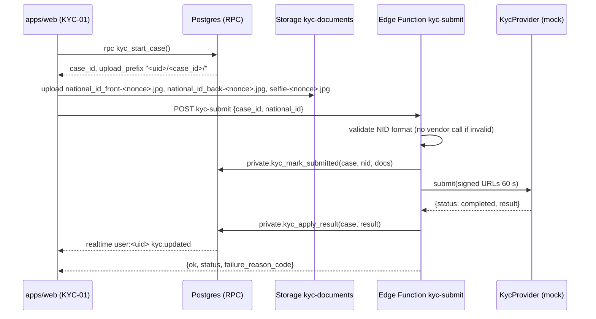

# Data contract ST-005: KYC T1 with mock ID OCR and selfie liveness

- Story: `backlog/stories/ST-005.md` · Owner: integration · Helpers: supabase-backend, react-frontend, security
- Architecture: `docs/decisions/ADR-002-architecture.md` §12 (encryption), §13 (adapters) · Conventions, enums and errors: `DATA_MODEL.md`
- PRD: 2.2 (T1), 3.4 step 2 (< 3 min), 3.9 A12 (linked accounts), 8.4 (encrypted PII), 8.6 (`kyc_documents`)
- Assumptions: Q-36 (auto-approve above a score), Q-38 (no passport in the MVP), Q-39 (same NID = possible linked account), Q-47 (NID encrypted with a Vault key)
- Migration: `<ts>_st005_kyc.sql` (third in the chain)

---

## 1. Flow (who calls what)



## 2. Tables

### 2.1 `public.kyc_cases`
| Column | Type | Constraints |
|---|---|---|
| `id` | `uuid` | pk |
| `user_id` | `uuid` | `not null references profiles(id)` |
| `tier_target` | `kyc_tier` | `not null default 'T1' check (tier_target in ('T1','T2'))` (sprint 1 creates only T1) |
| `status` | `kyc_case_status` | `not null default 'draft'` |
| `attempt_no` | `int` | `not null` (per user, 1-based) |
| `provider` | `text` | `not null default 'mock'` |
| `provider_ref` | `text` | vendor case id |
| `national_id_last4` | `char(4)` | shown to the user |
| `national_id_hash` | `bytea` | HMAC-SHA256(NID, Vault `pii_pepper`) |
| `national_id_enc` | `bytea` | `pgp_sym_encrypt(NID, Vault pii_key)` |
| `key_version` | `smallint` | `not null default 1` |
| `ocr_full_name_ar` / `ocr_full_name_en` | `text` | from OCR |
| `ocr_birth_date` | `date` | from OCR |
| `liveness_score` / `face_match_score` | `numeric(4,3)` | `check (between 0 and 1)` (scores, not money) |
| `flags` | `text[]` | `not null default '{}'`. Values: `low_score`, `ocr_mismatch`, `possible_linked_account`. **Hidden from the user** |
| `decision_reason` | `text` | internal, e.g. `auto_approved`, `rules:needs_review`, `vendor:hard_fail` |
| `failure_reason_code` | `text` | user-facing: `document_unreadable`, `face_mismatch`, `liveness_failed`, `id_expired`, `vendor_error` |
| `reviewer_id` | `uuid` | `references profiles(id)` (ST-022) |
| `reviewed_at`, `submitted_at`, `decided_at` | `timestamptz` | |
| `created_at` / `updated_at` | `timestamptz` | `not null default now()` |

Indexes and constraints:
- `unique (user_id) where status in ('draft','submitted','needs_review')`: one open case per user;
- `(national_id_hash)`;
- `(status, submitted_at) where status = 'needs_review'` (review queue, ST-022);
- `unique (user_id, attempt_no)`.

### 2.2 `public.kyc_documents`
| Column | Type | Constraints |
|---|---|---|
| `id` | `uuid` | pk |
| `case_id` | `uuid` | `not null references kyc_cases(id)` |
| `user_id` | `uuid` | `not null references profiles(id)` |
| `type` | `kyc_document_type` | `not null` |
| `storage_bucket` | `text` | `not null default 'kyc-documents'` |
| `storage_path` | `text` | `not null unique` (`<uid>/<case_id>/<type>-<nonce>.<ext>`) |
| `mime` | `text` | `not null check (mime in ('image/jpeg','image/png','image/webp','image/heic'))` |
| `size_bytes` | `int` | `not null check (size_bytes between 1 and 10485760)` |
| `sha256` | `bytea` | |
| `created_at` | `timestamptz` | `not null default now()` |

Constraint: `unique (case_id, type)`. Rows are written by `kyc-submit` (service role) from the newest storage object per type. **No client inserts.**

### 2.3 `private.kyc_vendor_results`
`id bigint identity pk`, `case_id uuid not null`, `received_at timestamptz default clock_timestamp()`, `payload jsonb not null`. The adapter **redacts the NID** in the payload (it keeps only the last 4 digits) before storing. No client access.

### 2.4 Storage bucket `kyc-documents`
- `public = false`, `file_size_limit = 10 MB`, allowed MIME types as above. **No public URLs.**
- Path convention: `<auth.uid()>/<case_id>/<type>-<nonce>.<ext>`. Uploads never overwrite: a re-take uploads a new nonce, and the newest file per type wins.

## 3. Functions

### 3.1 `public.kyc_start_case() returns public.kyc_start_result` (authenticated)
```sql
create type public.kyc_start_result as (
  ok boolean, error_code text, case_id uuid, upload_prefix text,
  status kyc_case_status, retry_after_ms int
);
```
Checks in this order:
1. `NOT_AUTHENTICATED` / `ANONYMOUS_NOT_ALLOWED`.
2. `USER_BANNED` (via `private.user_can_transact`).
3. `kyc_tier >= 'T1'` → `KYC_ALREADY_VERIFIED`.
4. An open case in `submitted` or `needs_review` → `KYC_IN_PROGRESS` (with `case_id` and `status`).
5. An open `draft` case → return it (idempotent).
6. `failed` cases in the last 24 h ≥ `kyc.max_failed_cases_24h` → `KYC_ATTEMPTS_EXCEEDED` with `retry_after_ms`.
7. `hit_rate_limit('kyc:start', uid, 10, 3600)` → `RATE_LIMITED`.
8. Insert a `draft` case with the next `attempt_no` and return `upload_prefix = '<uid>/<case_id>/'`.

### 3.2 `public.kyc_my_status() returns public.kyc_status_result` (authenticated)
The only way the user reads KYC data. They get **no SELECT** on `kyc_cases`, so flags, hashes and scores never reach the client.
```sql
create type public.kyc_status_result as (
  kyc_tier kyc_tier, case_id uuid, status kyc_case_status,
  failure_reason_code text, national_id_last4 text,
  ocr_full_name_ar text, updated_at timestamptz
);
```
The UI maps the status as follows:

| Status | UI |
|---|---|
| `draft` | continue the upload |
| `submitted` | "Checking…" |
| `approved` | success |
| `needs_review` | "Under review" |
| `failed` | show the reason, and "Try again" |
| `rejected` | show the reason, and "Contact support" (ST-022) |

### 3.3 Edge Function `kyc-submit` (user JWT)
- **Input:** `{ "case_id": "uuid", "national_id": "14 digits (Latin or Arabic-Indic; normalised)" }`.
- **Steps:**
  1. Verify the JWT and normalise the digits.
  2. Run `validateEgyptianNationalId(nid)` from `packages/shared/nationalId.ts`, shared with the client. It requires: 14 digits; first digit `2` (1900s) or `3` (2000s); digits 2–7 a valid `YYMMDD` date, not in the future; digits 8–9 a known governorate code (`01–04, 11–19, 21–29, 31–35, 88`). The last digit is a check digit with no public algorithm, so it is not validated. On failure → 400 `INVALID_NATIONAL_ID`, **with no vendor call and no DB write** (AC).
  3. Load the case as the user. It must be owned by the user and in `draft`, otherwise → `NOT_FOUND` / `KYC_IN_PROGRESS`.
  4. List the storage objects under the prefix. If any of the 3 types is missing → 400 `KYC_DOCUMENTS_MISSING` with `missing[]`.
  5. Call `private.kyc_mark_submitted(case_id, nid, docs jsonb)` (service role). It stores `national_id_enc`, `national_id_hash` and `last4`, inserts the `kyc_documents` rows, sets `status = 'submitted'` and `submitted_at`, and writes the audit row.
  6. Call `KycProvider.submit({ caseId, documents: signedUrls(60 s) })`.
     - Mock: 2–5 s delay, then a fixture is chosen by the NID suffix (§6).
     - Vendor error or timeout (> 30 s) → `private.kyc_revert_to_draft(case_id)` and return 502 `KYC_VENDOR_ERROR`. The user can retry with the same files.
  7. If the result is `completed` → `private.kyc_apply_result(case_id, result jsonb)`. If `pending` (async vendors later) → return `submitted`; a future `kyc-webhook` applies the result.
- **Output:** `{ ok: true, data: { case_id, status, failure_reason_code } }`.
- **Errors:** `NOT_AUTHENTICATED`, `INVALID_NATIONAL_ID`, `NOT_FOUND`, `KYC_IN_PROGRESS`, `KYC_DOCUMENTS_MISSING`, `KYC_VENDOR_ERROR`, `RATE_LIMITED` (5 submits per hour per user), `USER_BANNED`.

### 3.4 `private.kyc_apply_result(p_case_id uuid, p_result jsonb) returns kyc_case_status` (service role only)
`p_result` is the normalised adapter output: `{ outcome: 'completed'|'hard_fail', vendor_reason?, ocr: { nid, full_name_ar, full_name_en, birth_date }, liveness_score, face_match_score }`.

The rules are evaluated in order. Flags accumulate, and the first terminal decision wins.
1. `outcome = 'hard_fail'` → `failed`, with `failure_reason_code` = the vendor reason mapped to the user codes. The user can start a new case (AC: "sees the reason and can retry").
2. OCR NID ≠ submitted NID, **or** OCR birth date ≠ the date encoded in the NID → flag `ocr_mismatch`.
3. `least(liveness, match) < kyc.t1.auto_approve_min_score` → flag `low_score`.
4. `national_id_hash` equals another user's `profiles.national_id_hash`, or another user's `kyc_cases.national_id_hash` with status in `submitted`, `needs_review` or `approved` → flag `possible_linked_account` (A12, Q-39).
5. Any flag → `needs_review` (handled by the KYC Reviewer in ST-022). No flags → `approved`: set `profiles.kyc_tier = greatest(kyc_tier, 'T1')` and `profiles.national_id_hash`, and fill `name_ar`/`name_en` if empty.

Then:
- `decided_at = clock_timestamp()`;
- the raw payload goes to `kyc_vendor_results`;
- `audit_logs` gets `kyc.decision` (actor `vendor`, with before/after status and flags);
- realtime `user:<uid>` gets `kyc.updated`.

Tier only ever goes **up** in this function. A downgrade is a staff action (ST-047). `profiles.national_id_hash` is `UNIQUE`, so two approved accounts can never share an NID. The reviewer must resolve a linked-account case before approving.

### 3.5 `private.kyc_signed_url(p_document_id uuid)` (ST-022, defined now)
Only callable through an admin Edge Function, after `has_permission('kyc.review')`. It returns a 60 s signed URL and writes an `audit_logs` row `kyc.document_viewed`.

## 4. RLS and storage policies

**Plain words:**

| Object | anon | authenticated (owner) | KYC Reviewer (`kyc.review`, aal2) | service role |
|---|---|---|---|---|
| `kyc_cases` | none | **no direct SELECT**; reads go through `kyc_my_status()`; writes through RPC/EF only | SELECT all | all |
| `kyc_documents` | none | none | SELECT all | all |
| `kyc_vendor_results` (private) | none | none | none (raw payloads are read via a function in ST-022 if ever needed) | all |
| storage `kyc-documents` | none | INSERT into own `<uid>/<case_id>/` while that case is `draft`; **no SELECT, UPDATE or DELETE** | SELECT (to create signed URLs) | all |

```sql
alter table public.kyc_cases enable row level security;
revoke all on public.kyc_cases from anon, authenticated;
grant select on public.kyc_cases to authenticated;            -- needed for the reviewer policy only
create policy kyc_cases_reviewer_select on public.kyc_cases
  for select to authenticated using ((select private.has_permission('kyc.review')));

alter table public.kyc_documents enable row level security;
revoke all on public.kyc_documents from anon, authenticated;
grant select on public.kyc_documents to authenticated;
create policy kyc_documents_reviewer_select on public.kyc_documents
  for select to authenticated using ((select private.has_permission('kyc.review')));

alter table private.kyc_vendor_results enable row level security;  -- no policies

-- Storage
create policy kyc_docs_owner_insert on storage.objects
  for insert to authenticated
  with check (
    bucket_id = 'kyc-documents'
    and (storage.foldername(name))[1] = (select auth.uid())::text
    and private.kyc_case_is_open_draft(((storage.foldername(name))[2])::uuid, (select auth.uid()))
    and storage.filename(name) ~ '^(national_id_front|national_id_back|selfie)-[a-z0-9]{8,32}\.(jpg|jpeg|png|webp|heic)$'
  );
create policy kyc_docs_reviewer_select on storage.objects
  for select to authenticated
  using (bucket_id = 'kyc-documents' and (select private.has_permission('kyc.review')));
```
`private.kyc_case_is_open_draft(case_id, uid)` is a policy helper (`SECURITY DEFINER`, `STABLE`, `EXECUTE` granted to `authenticated`).

## 5. Realtime
- `user:<uid>`, event `kyc.updated`: `{ "v":1, "case_id":"…", "status":"approved|needs_review|failed|rejected", "failure_reason_code":null, "kyc_tier":"T1", "server_ts":"…" }`. AU-04 listens for it to continue the Join to Bid flow (ST-008) without a reload.

## 6. Adapter interface and mock fixtures

```ts
// supabase/functions/_shared/adapters/kyc/types.ts
export interface KycSubmitInput { caseId: string; nationalId: string; documents: { type: 'national_id_front'|'national_id_back'|'selfie'; url: string }[] }
export type KycResult =
  | { outcome: 'completed'; ocr: { nid: string; fullNameAr: string; fullNameEn?: string; birthDate: string }; livenessScore: number; faceMatchScore: number; raw: unknown }
  | { outcome: 'hard_fail'; vendorReason: 'document_unreadable'|'face_mismatch'|'liveness_failed'|'id_expired'; raw: unknown };
export interface KycProvider {
  submit(input: KycSubmitInput): Promise<{ status: 'completed'; result: KycResult } | { status: 'pending'; providerRef: string }>;
  parseCallback?(req: Request): Promise<{ providerRef: string; result: KycResult }>;
}
```

Mock fixtures, chosen by the **last 4 digits** of the submitted NID (QA uses synthetic NIDs that pass the format check):

| Suffix | Result |
|---|---|
| `…0001` (or anything not listed) | pass: OCR echoes the NID, scores 0.97/0.95 → `approved` |
| `…0002` | low score 0.60 → `needs_review` (`low_score`) |
| `…0003` | OCR returns a different NID → `needs_review` (`ocr_mismatch`) |
| `…0004` | `hard_fail: document_unreadable` → `failed` |
| `…0005` | `hard_fail: liveness_failed` → `failed` |
| `…0009` | vendor timeout → `KYC_VENDOR_ERROR`, case back to `draft` |
| Same NID on a 2nd account | `needs_review` (`possible_linked_account`) |

## 7. TypeScript types (expected from `supabase gen types`)

```ts
export type KycCaseStatus = 'draft' | 'submitted' | 'approved' | 'needs_review' | 'rejected' | 'failed';
export type KycDocumentType = 'national_id_front' | 'national_id_back' | 'selfie';

// Functions['kyc_start_case']
export interface KycStartCase { Args: Record<string, never>; Returns: {
  ok: boolean; error_code: string | null; case_id: string | null; upload_prefix: string | null;
  status: KycCaseStatus | null; retry_after_ms: number | null } }

// Functions['kyc_my_status']
export interface KycMyStatus { Args: Record<string, never>; Returns: {
  kyc_tier: 'T0' | 'T1' | 'T2'; case_id: string | null; status: KycCaseStatus | null;
  failure_reason_code: string | null; national_id_last4: string | null;
  ocr_full_name_ar: string | null; updated_at: string | null } }

// Edge Function kyc-submit (packages/shared/api/kyc.ts, hand-written, not generated)
export interface KycSubmitRequest { case_id: string; national_id: string }
export type KycSubmitResponse =
  | { ok: true; data: { case_id: string; status: KycCaseStatus; failure_reason_code: string | null } }
  | { ok: false; error_code: 'NOT_AUTHENTICATED'|'INVALID_NATIONAL_ID'|'NOT_FOUND'|'KYC_IN_PROGRESS'|'KYC_DOCUMENTS_MISSING'|'KYC_VENDOR_ERROR'|'RATE_LIMITED'|'USER_BANNED'; message: string; details?: { missing?: KycDocumentType[]; retry_after_ms?: number } };
```

## 8. Backend tests

pgTAP / Deno:
1. Each fixture in §6 gives the expected status, flags and `profiles.kyc_tier`. Only "pass" upgrades to T1.
2. `INVALID_NATIONAL_ID` cases (13 digits, first digit 1, month 13, governorate 99, a future date) → 400, and the mock adapter's call counter stays at 0.
3. Duplicate NID: user A is approved with NID X; user B submits X → B `needs_review` with `possible_linked_account`. Approving B directly (setting `profiles.national_id_hash`) violates the unique constraint.
4. `kyc_start_case` while `submitted` → `KYC_IN_PROGRESS`. When T1 → `KYC_ALREADY_VERIFIED`. After 5 failed cases in 24 h → `KYC_ATTEMPTS_EXCEEDED`.
5. RLS: user A `select from kyc_cases` → 0 rows (even own rows). `kyc_my_status()` returns only A's case. A cannot read B's status by any API.
6. Storage: A uploads to `A/<A's draft case>/selfie-abc12345.jpg` → ok. To `B/<case>/…` → denied. To A's `submitted` case → denied. A downloads their own file → denied. Reviewer with aal2 → allowed; with aal1 → denied. anon → denied.
7. `national_id_enc` decrypts to the NID only with the Vault key. `national_id_hash` is deterministic. No column or payload stores the full NID in plain text (grep `kyc_vendor_results.payload` and `audit_logs`).
8. Tier never decreases: applying a `failed` result to a T1 user leaves them T1.
9. Timing (Playwright on staging): the full path with the mock (start → 3 uploads → submit → approved) completes well under 3 min (AC).
